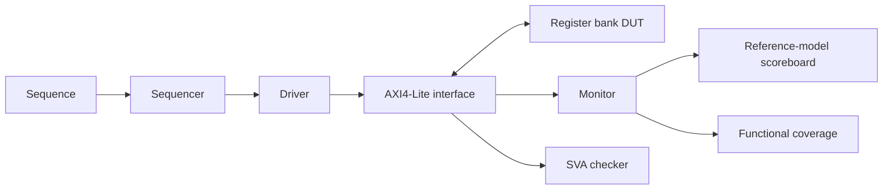

# AXI4-Lite Register Bank Verification with UVM

A SystemVerilog/UVM project that verifies a 32-bit AXI4-Lite register-bank slave using directed and constrained-random tests, a reference-model scoreboard, functional coverage, and SystemVerilog Assertions (SVA).

## Verification results

The following results were observed on **Cadence Xcelium 25.03-s001**, using **UVM 1.2** on **Rocky Linux 8.10**.

| Test | Seed | Writes / reads | Functional coverage | Simulated time | UVM errors / fatals |
| --- | --- | --- | --- | --- | --- |
| Directed | 1 (simulator default) | 1 / 1 | 40.18% | 110 ns | 0 / 0 |
| Constrained random | 12345 | 100 / 100 | 100.00% | 7040 ns | 0 / 0 |

Both runs reported zero scoreboard response errors and zero data errors. No SVA violations were reported in these runs.

Selected transcript lines are included in [the directed result](results/cadence/xcelium_directed_summary.txt) and [the random result](results/cadence/xcelium_random_seed12345_summary.txt). These are excerpts from the actual server runs, with machine-specific installation paths and tool banners omitted. The logs include the Xcelium coverage-configuration warning `CGPIDF` and note `COVCGN`.

[Result log organization](results/README.md) describes where to place the four full simulator logs.

**Coverage scope:** 100% refers to the coverpoints and crosses implemented in this project. Assertion activation coverage and complete AXI4-Lite protocol coverage have not been established. The numerical results above come from Xcelium; Questa scripts are also provided.

## DUT

The DUT implements eight 32-bit read/write registers accessed through five AXI4-Lite channels: AW, W, B, AR, and R.

| Property | Implementation |
| --- | --- |
| Address / data width | 32 bits / 32 bits |
| Register count | 8 |
| Register spacing | 4 bytes |
| Valid addresses | `0x00`, `0x04`, `0x08`, `0x0C`, `0x10`, `0x14`, `0x18`, `0x1C` |
| Reset value | All registers reset to zero |
| Write strobes | Four byte enables through `WSTRB[3:0]` |
| Valid access response | `OKAY` (`2'b00`) |
| Invalid access response | `SLVERR` (`2'b10`) |
| Invalid read data | Zero |
| Reset | Active-low asynchronous reset |
| Testbench clock period | 10 ns |

The slave captures AW and W independently before committing a write. Invalid writes leave the register bank unchanged. `AWPROT` and `ARPROT` are present but do not change access permissions in this DUT.

## Verification architecture



- **Sequences:** create request items and send them through the sequencer.
- **Driver:** drives the master signals, waits for initial reset release, and completes one transaction at a time. It includes a 1000-cycle transaction timeout.
- **Monitor:** observes handshakes, assembles completed write/read transactions, and publishes them through the agent analysis port.
- **Scoreboard:** maintains an independent register model, applies byte writes using `WSTRB`, and checks read data and responses.
- **Coverage subscriber:** samples the transactions received from the monitor.
- **SVA checker:** observes the interface directly from a module instantiated in `tb_top`.

The agent supports active and passive modes. Both supplied tests require an active agent.

## Tests and coverage

### Directed test

`axi_lite_directed_test` writes decimal `100` to address `0x08` with `WSTRB=4'b1111`, then reads the same address. The test checks that the scoreboard receives one write and one read.

### Constrained-random test

`axi_lite_random_test` runs 100 write/read pairs by default:

1. Randomize a write request's data, strobe, and address.
2. Select the address from the eight valid register addresses, `0x02` (unaligned), or `0x20` (outside the register bank).
3. Complete the write and read back the same address.
4. Check data and response using the scoreboard model.

The read request is derived from the write address. Timing is currently deterministic; the sequence randomizes transaction contents.

| Coverage goal | Implemented bins / combinations |
| --- | --- |
| Operation | Read, write |
| Address kind | Valid, invalid |
| Register index | All eight registers, for valid accesses |
| Response | `OKAY`, `SLVERR` |
| Write strobe | All 16 strobe patterns, for valid writes |
| Operation x register | Read and write to each register |
| Operation x response | Read/write with `OKAY`/`SLVERR` |

Five SVA properties check that `VALID` remains asserted and the channel payload remains stable after a sampled `VALID && !READY` condition on AW, W, B, AR, and R. Reset disables these checks. A run without violations does not show that every stall condition occurred.

## Repository layout

```text
.
|-- rtl/
|   `-- axi_lite_slave.sv
|-- tb/
|   |-- axi_lite_if.sv
|   |-- axi_lite_item.sv
|   |-- axi_lite_sequence.sv
|   |-- axi_lite_random_sequence.sv
|   |-- axi_lite_sequencer.sv
|   |-- axi_lite_driver.sv
|   |-- axi_lite_monitor.sv
|   |-- axi_lite_agent.sv
|   |-- axi_lite_scoreboard.sv
|   |-- axi_lite_coverage.sv
|   |-- axi_lite_env.sv
|   |-- axi_lite_directed_test.sv
|   |-- axi_lite_random_test.sv
|   |-- axi_lite_assertions.sv
|   |-- axi_lite_pkg.sv
|   `-- tb_top.sv
|-- sim/
|   |-- cadence/
|   |   |-- run_directed.sh
|   |   `-- run_random.sh
|   `-- questa/
|       |-- run_directed.do
|       `-- run_random.do
|-- results/
|   |-- cadence/
|   |   |-- xcelium_directed_summary.txt
|   |   `-- xcelium_random_seed12345_summary.txt
|   |-- questa/
|   `-- README.md
|-- .gitattributes
|-- .gitignore
`-- README.md
```

`work/` is generated locally when running simulations and is excluded from Git.

## Running the project

Load your simulator environment and license configuration first. Cadence scripts select `CDNS-1.2`; Questa scripts use the installation's `mtiUvm` library mapping.

Scripts expect to run from `work/directed_test` or `work/random_test`, two directories below the repository root. Each command block below starts at the repository root. Use a separate checkout/server when comparing Cadence and Questa outputs.

### Cadence Xcelium

```bash
mkdir -p work/directed_test work/random_test
cp sim/cadence/run_directed.sh work/directed_test/
cp sim/cadence/run_random.sh work/random_test/

(cd work/directed_test && bash run_directed.sh)
(cd work/random_test && bash run_random.sh)
```

The main logs are `work/directed_test/directed.log` and `work/random_test/random.log`. Build files and coverage databases are generated inside the corresponding run directory. `-covoverwrite` allows replacement of existing coverage data for a repeated output directory.

On the reported Rocky Linux setup, C development headers were needed for DPI library generation. If `stdio.h` is missing, an administrator can install `glibc-devel` and `glibc-headers` using DNF before rebuilding.

### Siemens Questa

```bash
mkdir -p work/directed_test work/random_test
cp sim/questa/run_directed.do work/directed_test/
cp sim/questa/run_random.do work/random_test/

(cd work/directed_test && vsim -c -do run_directed.do)
(cd work/random_test && vsim -c -do run_random.do)
```

The scripts produce `directed.log` / `random.log` and `directed.wlf` / `random.wlf` in their run directories. They are configured to exit after the run. Functional coverage is printed in the log; the current Questa scripts do not explicitly save a UCDB file.

### Changing the seed

Edit the source script, then copy it into the run directory again:

- Cadence: `seed=12345` in `sim/cadence/run_random.sh`.
- Questa: `set seed 12345` in `sim/questa/run_random.do`.

Use the same seed, source, and simulator configuration when reproducing a failure. Random streams can differ across simulators. The number of pairs is configured by `seq.num_pairs = 100` in `tb/axi_lite_random_test.sv`.

### Checking a run

Inspect the scoreboard summary, UVM report counts, coverage summary, and simulator errors. A typical successful random-test summary is:

```text
[COV_SUMMARY] transactions=200 functional_coverage=100.00%
[SCB_SUMMARY] writes=100 reads=100 response_errors=0 data_errors=0
UVM_ERROR : 0
UVM_FATAL : 0
```

A zero UVM error count alone does not account for separate simulator errors. The scripts do not implement an automated CI pass/fail gate.

## Current scope and possible extensions

- The master driver serializes transactions; concurrent read/write traffic is not tested.
- AW and W start together in the supplied driver. Random AW/W skew and prolonged response backpressure are future stimulus extensions.
- Reset is applied before traffic. The driver reports a fatal error for reset during a transaction, and the scoreboard has no runtime-reset synchronization.
- The SVA set covers five channel-stability rules. Dedicated assertion activation coverage and broader protocol checks are future work.
- The published random result is one run with seed `12345`; a multi-seed regression is future work.
- Code coverage, performance measurements, and synthesis results are not reported.
