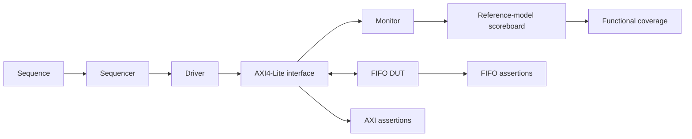

# UVM Verification of an AXI4-Lite FIFO Peripheral

This SystemVerilog/UVM project verifies a 16-entry, 32-bit FIFO accessed through an AXI4-Lite slave interface. The testbench combines directed and constrained-random tests, a queue-based reference model, functional coverage, and SystemVerilog Assertions (SVA).

## Results

| Xcelium 25.03-s001, UVM 1.2 | Seed | Writes / reads | Functional coverage | UVM errors / fatals |
| --- | ---: | ---: | ---: | ---: |
| [Directed FIFO test](results/cadence/directed.log) | 1 | 17 / 18 | 100% | 0 / 0 |
| [Constrained-random FIFO test](results/cadence/random.log) | 12345 | 111 / 89 | 100% | 0 / 0 |

Both runs reported zero scoreboard data and response mismatches. The coverage percentages apply to the implemented bins and crosses.

## FIFO interface

| Access at `0x00` | Behavior |
| --- | --- |
| Write with `WSTRB = 4'hF` and space available | Enqueue one 32-bit word and return `OKAY` |
| Read with data available | Dequeue the oldest word and return `OKAY` |
| Write with a full FIFO or unsupported write strobe | Return `SLVERR` |
| Read from an empty FIFO | Return zero with `SLVERR` |

An access to any other address returns `SLVERR`. The slave captures AW and W independently before committing the write. The testbench uses a 10 ns clock and applies an active-low reset before traffic.

## Verification



- The driver completes one transaction at a time and supports independent AW/W delays and B/R response backpressure.
- The monitor saves addresses and write data in queues at the AW, W, and AR handshakes. It assembles completed transactions at B or R.
- The scoreboard checks responses and read data against a software FIFO. It sends the occupancy before each checked operation to the coverage subscriber.
- Functional coverage crosses read/write with empty, partial, and full occupancy, and with `OKAY` and `SLVERR`.
- SVA checks AXI payload stability during stalls, FIFO count updates, and read/write pointer wraparound.

**Directed test.** Read from empty, fill all 16 entries, attempt one extra write, drain the FIFO in order, then read from empty again.

**Random test.** Generate 200 sequential reads or writes at `0x00`. Write data is randomized and writes use `WSTRB = 4'hF`. AW, W, BREADY, and RREADY delays are individually randomized from 0 to 3 clock cycles. The test compares the generated read and write counts with the scoreboard counts.

## Running the tests

Start at the repository root after loading the simulator environment and license.

### Cadence Xcelium

```bash
mkdir -p work/directed_test work/random_test
cp sim/cadence/run_directed.sh sim/cadence/wave_directed.tcl work/directed_test/
cp sim/cadence/run_random.sh sim/cadence/wave_random.tcl work/random_test/

(cd work/directed_test && bash run_directed.sh)
(cd work/random_test && bash run_random.sh)
```

Each run directory contains its log and an SHM waveform of `tb_top.axi_if`. To open the random waveform, run `simvision random.shm` from `work/random_test`. The random seed is set in `sim/cadence/run_random.sh`.

## Repository layout

- [rtl/](rtl/) contains the AXI4-Lite FIFO slave.
- [tb/](tb/) contains the UVM testbench, tests, and assertions.
- [sim/](sim/) contains simulator scripts.
- [results/](results/) contains simulation logs.

---

Developed by **Võ Thanh Toàn**\
University of Information Technology, VNU-HCM.
